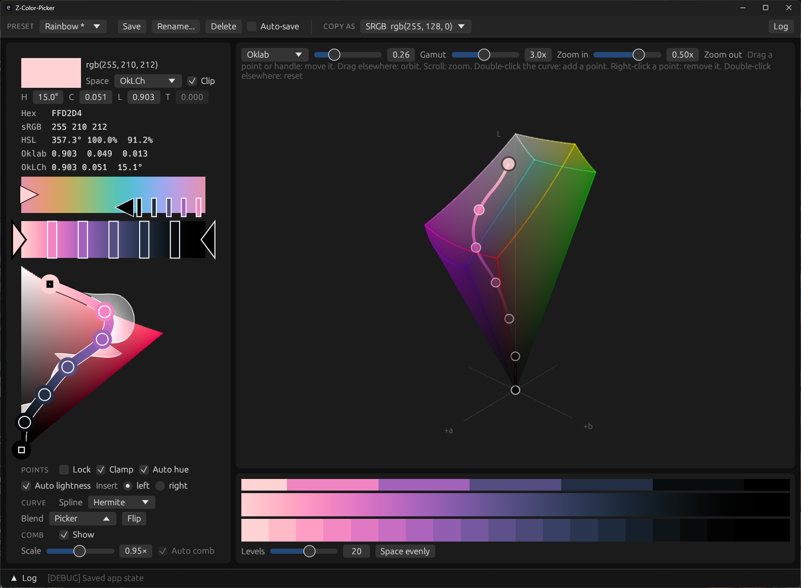

# Z-Color-Picker

# MAIN FEATURES

- Easy creation of gradients
- Interactive ui
- Gradient preview
- 3D gradient view
- Multiple Spline Modes
- Multiple Color Spaces
- Curvature comb
- Create/Save/Load Presets
- Quickly Export
- Coded in Rust

# HOW TO

## Usage

Place control points on the square and hue bar; the gradient is interpolated through them. "Auto hue" & "Auto Lightness" are core features that auto adjust control points for you. Adjust control points with the color picker or 3d viewer.

### Controls

- Double-click: Add control-point
- Right-click: Remove control-point
- Drag: Move a control-point
- Middle-click: Copy screen color as the selected format, on previewer, copies image to clipboard
- 3D view: Orbit & Zoom
- F12: Debug window
- Esc: Quit

### Presets

- One JSON file per preset in `./presets`
- `<NEW>` in the combo creates a preset, `<None>` clears the selection
- `*` in the combo marks unsaved changes
- Switching away from unsaved changes asks to save, discard or cancel

# TODO:

## References
### https://acko.net/blog/curvature-beziers/

## TODO: Features

- "Regular Color pick" for control points
- Visualization curves
  - Value
  - Saturation
  - Hue
- View multiple presets at the same time
- Photoshop workflow, plugin integration?
- "Auto gradient button"
- "Random gradient button"
- "Screen-mouse-drag" gradient picker
- Undo feature
- embed image in executable

# UNREAL ENGINE AND PHOTOSHOP

## Export

The Export group in the toolbar writes the gradient to files named after the selected preset (else `Gradient`):

- Folder...: where the files go (it must already exist), and On save.
- Export: writes the current gradient now.
- On save (in Folder...): also exports each time a preset is written (Save, Create, Auto-save).
- `<name>.csv`: Unreal Curve Linear Color, 64 keys, linear colors
- `<name>.png`: 256x1 lookup strip, sRGB
- `<name>.grd`: Photoshop gradient, 32 stops
- `<name>.ase`: Adobe swatches, one per control point

## Unreal

- CSV: the first import of a new file opens the "DataTable Options" window; choose Curve Linear Color. Later exports to the same file reimport into that curve once you click Import on Unreal's change prompt (Editor Preferences > Loading & Saving > Auto Reimport; the export folder must be under the project's Content folder).
- A CSV reimport probably leaves a Curve Atlas using the curve stale: Unreal rebuilds the curve without notifying it (read from the engine source, not reproduced). Edit or reload the atlas if it doesn't update. For materials, prefer the PNG strip or the live link.
- PNG: import as a texture with sRGB on, no mipmaps and Clamp tiling.

## Photoshop

- `.grd`: Window > Gradients, panel menu > Import Gradients...
- `.ase`: Window > Swatches, panel menu > Import Swatches...

## Copy and paste

- Copy as UE LinearColor: `(R=..,G=..,B=..,A=..)`, linear floats. Copy as UE Color: `(B=..,G=..,R=..,A=..)`, 8-bit sRGB. Click the color readout or press Ctrl+C, then paste on a Linear Color or Color property in Unreal's Details panel.
- Copy UE array (Export group): copies the gradient as 64 linear colors, `((R=..,G=..,B=..,A=..),(R=..,...))`. Paste it on an Array of Linear Color property (Blueprint defaults, data assets). No folder needed.

## Live link

Optional, behind a cargo feature: `cargo run --release --features unreal-live`.

- Install the editor plugin: see `unreal/ZColorPickerBridge/README.md`.
- Turn Live on in the toolbar's Unreal group. Target... sets the Remote Control port (default 30010) and the asset folder (default `/Game/ZColorPicker`); the folder applies on Enter or when the popup closes.
- The gradient appears as a Curve Linear Color at `/Game/ZColorPicker/<name>` (the export name, every character outside `A-Z`, `a-z`, `0-9` and `_` replaced by `_`) and updates while you drag. Curve Atlas rows follow.
- Preset names that differ only in those characters (`Warm Sky`, `Warm_Sky`) write the same curve; the Live hover and Target... show the path.
- Niagara copies the curve data when the asset is picked: re-select the curve asset to resync.
- The status beside the toggle reads Pushed, or the error in red.
- While Unreal can't be reached, a push is tried again every 2 s, so the editor can start after the app. An error from the plugin itself (such as a folder outside `/Game`) waits for the next change. Esc in Target... cancels an edit.
