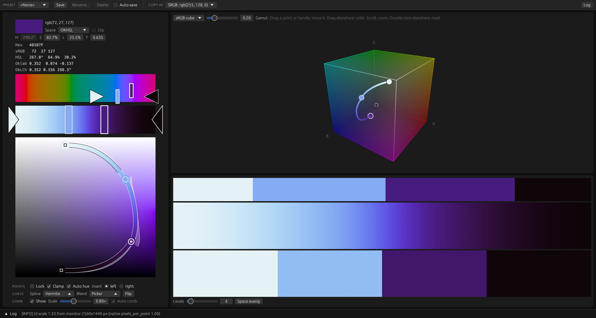

# Z-Color-Picker

# MAIN FEATURES

- Easy creation of gradients
- Interactive ui
- Gradient preview
- Multiple Spline Modes
- Create/Save/Load Presets
- Quickly Export
- Coded in Rust

# HOW TO

## Usage

The window is the picker column on the left, the 3D view over the previewer on the right, the toolbar on top and the log drawer at the bottom.
Each control point is a value in the picker space: HSV, HSL, OKHSV, OKHSL, OkLCh or Oklab (Space, under the selected color's readout).
Hue of each individual control point can be changed in the hue bar, and saturation & value (lightness in HSL and OKHSL) in the 2d slider. In OkLCh the square is chroma by lightness; in Oklab it is a by b and the bar is lightness, drawn through the selected point.
T, the strip under the hue bar, is each point's position along the gradient: the first and last points stay at 0 and 1, the middle points can be dragged between their neighbours.
The selected control point's color is shown in the top left, with its readout beside it; the H, S, V (L) and T fields under them show its values and take exact ones. The previewer shows the control point colors, the gradient using the selected spline mode, and a quantized gradient.
The rows under the fields show the selected color as Hex, sRGB (0-255), HSL, Oklab and OkLCh.
Between the points, the gradient is blended in the Blend space (Curve row): the picker space itself, sRGB, Linear RGB, Oklab or OkLCh.
The picker column keeps the size it needs: the other panes give way, the log drawer can't be dragged taller than the room left above it (in a window too small for both it shrinks to its header first, and gets its height back when the window grows), and in a window too small for the picker, it scrolls.
The 3D view above the previewer draws the gradient curve, blended as the previewer shows it, and its control points inside a color space, where the points and the selected point's Bezier handles can be dragged too.
To create a new preset, click the preset combo box and select `<NEW>`

## Controls

- Double-click-M1: Add control-point
- Drag-M1: Move a control-point, a Bezier tangent handle, a hue gizmo, or a middle point's T marker
- Right-click-M2: Remove control-point
- Drag-M1 on a middle previewer key color: move its point's T
- Click the color readout or Ctrl+C: copy the selected point's color in the Copy-as format
- Click a Hex/sRGB/HSL/Oklab/OkLCh row: copy the selected point's color in that row's Copy-as format (`hsl()`, `oklab()`, ...), with more decimals than the row shows
- Middle-click: Copy screen color as the selected format, on previewer, copies image to clipboard
- H/S/V/T fields (H/C/L/T in OkLCh, L/a/b/T in Oklab): drag, or click and type a value; Enter or Tab commits, Esc cancels. S, V and the HSL / OKHSL L are in % of the square; OkLCh and Oklab show absolute values with 3 decimals, typed in the same units: L from 0 to 1, chroma from 0 to the square's 0.33, a and b signed, 0 at gray. H is read-only for middle points under Auto hue, T for the first and last points; with Lock, S and V move every point
- Click the log header (bottom of the window): expand or collapse the log; collapsed, it shows the last line; expanded, drag its top edge to resize it
- 3D view: Drag-M1 on a point (or, in Bezier mode, on a handle of the selected point) moves it across the view, keeping its T and staying inside sRGB; Drag-M1 elsewhere orbits; click a point to select it; scroll zooms, double-click resets the camera; hover a point, handle or the curve for its hex color
- F12: debug window with the control point values
- Esc: quit (ignored while typing, or while a popup, dialog or the Create Preset window is open)

## Toolbar

Groups, left to right: Preset and Copy as; Log at the right end.

- Preset: Pick a preset, then Save, Rename... (opens a name field; Enter renames), Delete, Auto-save (rewrite the selected preset file after every edit). A failed save shows its error at the end of the row
- Copy as: Text format for a copied color, including CSS `hsl()`, `oklab()` and `oklch()`; previewer strips are copied as images
- Log (right end): Expand or collapse the log drawer (highlighted while expanded); collapsed by default

## Options

Picker (under the selected color's readout):
- Space: Color space of the square and the hue bar: HSV, HSL, the perceptual OKHSV and OKHSL (built on Oklab), or OkLCh and Oklab themselves, which reach outside sRGB (shown with chroma reduced to fit). Switching converts every point and keeps its color, except middle points under Auto hue: their hues are re-interpolated in the new space; it is saved with the preset
- Clip (OkLCh and Oklab): Clip to sRGB: colors outside sRGB are left blank on the square and bar, and every point or Bezier handle you move, type in or convert is pulled into sRGB by reducing its chroma; under Lock the group stops at the sRGB edge instead, keeping its shape. Dragging a hue out of sRGB and back gives the chroma back. Turning it on pulls in every point and handle once. Saved with the space

Points row (under the square):
- Lock: Apply any control point coordinate translation to all control points
- Clamp: Keep control points inside the S/V square and wrap hue into 0..1 (Oklab: clamp lightness into 0..1)
- Auto hue: Select hue for start/end control points, middle control point's hue is interpolated by T (shown as markers on the hue bar); off in Oklab, which has no hue
- Insert left/right: Side of the selected point where a new control point goes (start/end when none is selected)

Curve row (under the Points row):
- Spline: Linear, Bezier (drag the tangent handles) or Hermite (Catmull-Rom, automatic tangents, not drawn; the end segments follow the parabola through the three end points)
- Blend: Color space the gradient is interpolated in: Picker (the square's coordinates and hue, default), sRGB, Linear RGB, Oklab, or OkLCh (hue takes the short way around; a gray takes its neighbour's hue). The points keep their colors and the ribbon on the square follows the blended colors; a blended color outside sRGB loses chroma but keeps its lightness and hue; it is saved with the preset. Any blend but Picker turns off the comb and Auto comb
- Flip: Reverse the control point order (T is mirrored)

Comb row (under the Curve row):
- Show: Show the curvature comb (Bezier and Hermite, Picker blend)
- Scale: Length of the comb spikes
- Auto comb: Keep a curvature on each point and solve the handle lengths so the comb is continuous (Bezier only). Moving a point keeps the curvatures (the dragged point gives way when its segments can't meet its curvature); turning a handle turns its partner too; pulling a handle longer or shorter changes its point's curvature. `N unsolved` counts segments whose handle lengths can't meet their points' curvatures, which are left as they were

Previewer:
- Levels: Number of colors in the quantized gradient
- Space evenly: Spread the points evenly along the gradient (equal T steps)

3D view:
- Space: sRGB cube, Linear RGB cube, HSV cylinder, HSL cylinder, or Oklab (L up, a/b across, with the sRGB gamut outline)
- Gamut: Opacity of the shaded gamut faces (0 hides them); the curve and points show through the near faces

## Presets

- One JSON file per preset in `./presets`, relative to the working directory
- The combo marks unsaved changes with `*`; `<None>` clears the selection
- Picking another preset with unsaved changes asks to save, discard or cancel
- Save without a selection creates a preset; Delete asks first

# TODO:

## References
### https://acko.net/blog/curvature-beziers/

## TODO: Features

# Currently being worked on
- Control point ordering visuals on color picker
- Control point Hue visuals
- Size slider for color picker spline
- Spline mode interactivity

#

- Add confirm window for exiting when having an unsaved preset active.
- Regular Color pick for control points
- Visualization curves
  - Value
  - Saturation
  - Hue
- View multiple presets at the same time
- Photoshop workflow, plugin integration?
- Better ui widget dynamic rezising
- Polynomial spline mode
- Auto gradient button with "undo"
- Add Interpolation::Bezier with just one tanget point
- Screen-mouse gradient picker
